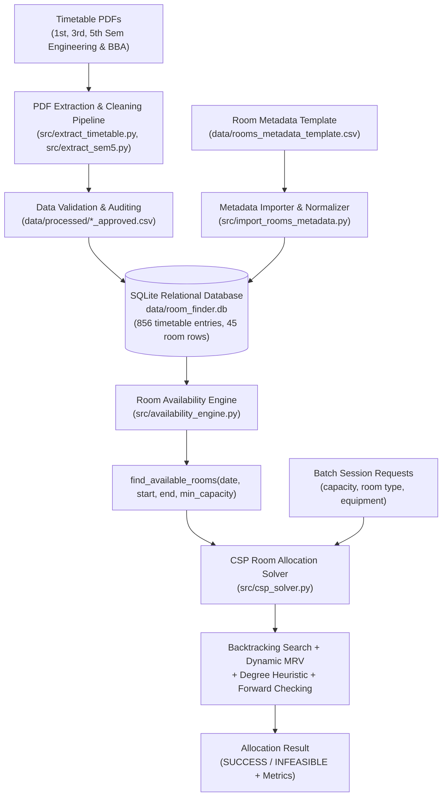
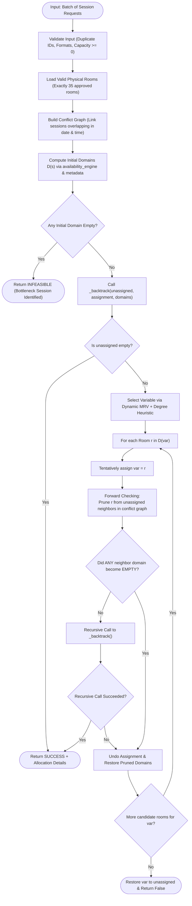

# AI Powered Intelligent Room Availability and Finder System

A university room availability and intelligent room recommendation system that integrates timetable schedule data, physical room metadata, deterministic availability search, and Constraint Satisfaction Problem (CSP) algorithms to solve academic venue scheduling and room finding.

---

## 1. Project Title
**AI Powered Intelligent Room Availability and Finder System**

---

## 2. Overview
The **AI Powered Intelligent Room Availability and Finder System** is an AI-driven academic infrastructure platform developed to automate the detection of free university classrooms, resolve room allocation bottlenecks, and prevent scheduling conflicts.

By integrating parsed timetable PDFs across multiple semesters and faculties, normalizing physical campus facilities into structured relational schemas, and applying Artificial Intelligence algorithms (Constraint Satisfaction with Backtracking, Minimum Remaining Values, Degree Heuristic, and Forward Checking), the system delivers high-precision room availability tracking and multi-session allocation.

---

## 3. Problem Statement
In higher education institutions:
- Classrooms, computer laboratories, and lecture halls are distributed across multiple blocks with varying seating capacities and specialized equipment (e.g., smartboards, projectors, lab computers).
- Timetables change dynamically across semesters, sections, elective batches, and effective date intervals (e.g., date-dependent venue handovers).
- Ad-hoc room bookings, guest lectures, makeup classes, and examination schedules often lead to double-bookings, capacity mismatches, or venue underutilization.
- Finding free, suitable rooms manually is error-prone, labor-intensive, and time-consuming.

---

## 4. Project Objectives
- **Centralize Campus Timetable & Venue Data:** Digitize, validate, and store heterogeneous academic timetable schedules and room inventory into a unified SQLite database.
- **Accurate Temporal Conflict Detection:** Ensure non-overlapping intervals, date-dependent ranges, and alternate venue allocations are handled deterministically without false positives.
- **Intelligent Constraint-Based Room Allocation:** Formulate and solve multi-session room assignment as a Constraint Satisfaction Problem (CSP) satisfying capacity, room type, facilities, timetable commitments, and mutual exclusion.
- **Modular & Extensible AI Architecture:** Build decoupled foundational modules (Database $\rightarrow$ Availability Engine $\rightarrow$ CSP Solver) ready for future route-finding (A* Search) and intelligent user interfaces.

---

## 5. Technologies Used
- **Programming Language:** Python 3.10+
- **Database Engine:** SQLite 3 (with foreign key constraints enabled)
- **Data Processing:** Python Standard Library (`sqlite3`, `csv`, `pathlib`, `datetime`, `dataclasses`, `typing`, `unittest`, `subprocess`, `shutil`)
- **PDF Extraction & Auditing:** Automated extraction pipeline parsing tabular PDF schedules into validated CSV datasets

---

## 6. Project Architecture / Workflow



---

## 7. Campus Building Information

The campus facilities modeled in the system span four primary academic building complexes:

| Building Code / Prefix | Building Full Name | Typical Facilities |
| :--- | :--- | :--- |
| **`EB1-`** | Engineering Block 1 (EB-1) | Standard Classrooms (Capacity 60) |
| **`EB2-`** | Engineering Block 2 (EB-2) | Standard Classrooms (Capacity 60) |
| **`TB-`** | Technology Block (TB) | Large Classrooms (Capacity 80) |
| **`IM-`** | Management Block (IM) | Management Classrooms (Capacity 60) |
| **Specialized Venues** | Campus Amphitheatres, LRC, AIC | Seminar Rooms (Capacity 100), Computer Labs (Capacity 60) |

### Assumed Campus Walking Distances
For future spatial route-finding and allocation optimization, the following walking distances are currently adopted:

| Route Between Buildings | Assumed Distance |
| :--- | :---: |
| **EB2 $\longleftrightarrow$ EB1** | **5 metres** |
| **EB1 $\longleftrightarrow$ Technical Block (TB)** | **10 metres** |
| **EB1 $\longleftrightarrow$ Management Building (IM)** | **40 metres** |
| **EB2 $\longleftrightarrow$ Management Building (IM)** | **50 metres** |

> **Note on Spatial Data:** These distances represent **approximate initial assumptions** for algorithmic route modeling and do not constitute measured campus geodetic survey data.

---

## 8. Database and Dataset

The system uses an SQLite database located at `data/room_finder.db`.

### Core Database Tables

#### 1. `rooms` (45 total records, 35 active physical rooms)
Stores campus rooms, laboratories, seminar halls, and tracking status.
| Column | Type | Constraints | Description |
| :--- | :--- | :--- | :--- |
| `room_id` | INTEGER | PRIMARY KEY AUTOINCREMENT | Unique room identifier |
| `room_number` | TEXT | NOT NULL | Room code (e.g., `"EB1-101"`, `"TB-102"`, `"BYOD"`) |
| `building` | TEXT | NOT NULL | Building block designation |
| `capacity` | INTEGER | NULLABLE | Maximum seating capacity (60, 80, 100) |
| `room_type` | TEXT | NULLABLE | Room classification (`Classroom`, `Computer Lab`, `Seminar Room`) |
| `equipment` | TEXT | NULLABLE | Comma-separated equipment (`AC`, `Smartboard`, `Projector`, `Computers`, etc.) |
| `notes` | TEXT | NULLABLE | Audit annotations or historical classification notes |

#### 2. `timetable_entries` (856 approved records)
Stores scheduled class sessions, lectures, and laboratory blocks.
| Column | Type | Constraints | Description |
| :--- | :--- | :--- | :--- |
| `entry_id` | INTEGER | PRIMARY KEY AUTOINCREMENT | Unique timetable entry ID |
| `room_number` | TEXT | NOT NULL | Foreign key referencing room |
| `department` | TEXT | NULLABLE | Academic department offering the course |
| `semester` | TEXT | NULLABLE | Academic semester (e.g., `"1st Semester"`, `"5th Semester"`) |
| `section` | TEXT | NULLABLE | Class section / batch identifier |
| `subject` | TEXT | NULLABLE | Subject name, course code, and faculty details |
| `day` | TEXT | NULLABLE | Day of the week (`Monday` to `Friday`) |
| `start_time` | TEXT | NULLABLE | Class start time in 24-hour format (`HH:MM`) |
| `end_time` | TEXT | NULLABLE | Class end time in 24-hour format (`HH:MM`) |
| `source_file` | TEXT | NULLABLE | PDF file from which the entry was ingested |
| `effective_start_date`| TEXT | NULLABLE | Start date for date-dependent classes (`YYYY-MM-DD`) |
| `effective_end_date` | TEXT | NULLABLE | End date for date-dependent classes (`YYYY-MM-DD`) |
| `schedule_type` | TEXT | NULLABLE | Schedule cadence (e.g., `"Regular Weekly"`) |
| `duration_minutes` | INTEGER | NULLABLE | Duration of the session in minutes |
| `notes` | TEXT | NULLABLE | Extraction and schedule notes |
| `needs_verification` | INTEGER | DEFAULT 0 | Flag for ambiguous entries (0 = verified) |
| `verification_reason`| TEXT | NULLABLE | Reason if verification required |
| `is_alternate_venue` | INTEGER | DEFAULT 0 | 1 if alternate or practical venue notation |

#### 3. `source_files`
Tracks metadata for source timetable PDF documents.
| Column | Type | Constraints | Description |
| :--- | :--- | :--- | :--- |
| `source_id` | INTEGER | PRIMARY KEY AUTOINCREMENT | Unique source file record ID |
| `file_name` | TEXT | NOT NULL | Name of the source timetable PDF |
| `department` | TEXT | NULLABLE | Department covered by the document |
| `semester` | TEXT | NULLABLE | Semester covered by the document |

### Approved Dataset Statistics
- **Total Approved Timetable Entries:** **856 entries**
  - *Engineering 1st Semester:* 298 entries
  - *Engineering 3rd Semester:* 184 entries
  - *Engineering 5th Semester:* 242 entries
  - *BBA Timetable:* 132 entries
- **Unresolved Visiting Faculty Entries:** **2 entries** (deliberately preserved in `data/processed/visiting_faculty_unresolved.csv` and excluded from physical room occupancy until venues are officially confirmed).
- **Physical Room Inventory:** **35 approved physical rooms** with complete metadata. Canonical `TB-109` is included (Capacity 80, Classroom, full equipment), while spaced alias `TB- 109` and non-physical strings (`EB1-1`, `EB1-2`, `EB2-2`, `EB2-4`, `TB-102/108`, `TB-102/112`, `Unassigned`, `Unspecified / TBD`) are strictly excluded.

---

## 9. Implemented Modules

### 1. Database Initialization & Utilities (`src/database.py`)
- Initializes `rooms`, `timetable_entries`, and `source_files` tables.
- Enforces SQLite foreign key constraints via `PRAGMA foreign_keys = ON;`.
- Provides safe, idempotent connection and table creation helpers.

### 2. Timetable PDF Processing Pipeline
- `src/extract_timetable.py` & `src/extract_sem5.py`: Parses PDF schedules into structured tabular records.
- `src/validate_data.py`: Audits time formatting, day names, duplicate rows, multi-slot classes, and date ranges.
- `src/create_approved_dataset.py`: Normalizes date splits (e.g., FinTech Monday class in IET Amphitheatre from Aug 3–31, transitioning to IM Amphitheatre from Sep 1–Dec 15).
- `src/import_to_db.py`: Safely populates `rooms` and `timetable_entries` without creating duplicate records.

### 3. Room Metadata Management (`src/import_rooms_metadata.py`, `src/export_rooms_template.py`)
- Standardizes room types (`Classroom`, `Computer Lab`, `Seminar Room`), seating capacities (60, 80, 100), and facilities (`AC`, `Smartboard`, `Projector`, `Computers`, `Wi-Fi`, `Power sockets`).
- Creates automated database snapshots in `data/backup/` before any updates.
- Export utility generates `data/rooms_metadata_template.csv` for manual inspection.

### 4. Room Availability Engine (`src/availability_engine.py`)
- Core function: `find_available_rooms(date_str, start_time_str, end_time_str, min_capacity=0)`.
- Validates 24-hour time formatting and calendar dates.
- Translates calendar dates to weekdays and evaluates whether entries fall within `[effective_start_date, effective_end_date]`.
- Implements strict interval non-overlap condition:
  $$\neg (\text{entry.end\_time} \le \text{req.start\_time} \lor \text{entry.start\_time} \ge \text{req.end\_time})$$
- Returns matching free rooms sorted by `room_number`.

### 5. CSP Room Allocation Solver (`src/csp_solver.py`)
- Formulates multi-session room scheduling as a Constraint Satisfaction Problem.
- Features `SessionRequest`, `AllocationResult`, and `CSPSolver`.
- Dynamically allocates rooms for concurrent or sequential session requests.

---

## 10. CSP Algorithm Explanation

The CSP solver assigns physical rooms to academic session requests satisfying all hard constraints:



### Key AI Techniques Implemented:
1. **Backtracking Search (DFS):**
   - Systematically navigates the search space of room assignments.
   - If a dead end is reached downstream, previous assignments are undone.
   - Overall problem is declared `INFEASIBLE` only after exhaustive exploration from the root call.
2. **Dynamic Minimum Remaining Values (MRV):**
   - At each recursive level, selects the unassigned session with the smallest current domain size $|D(s)|$.
   - Prioritizes highly constrained sessions (fail-first principle) to minimize search depth.
3. **Degree Heuristic Tie-Breaker:**
   - If multiple sessions have identical domain sizes, breaks ties by choosing the session with the most unassigned conflicting neighbors in the conflict graph.
4. **Forward Checking with Exact Domain Restoration:**
   - When a room is assigned to session $s$, it is immediately pruned from the domains of all overlapping, unassigned neighbor sessions.
   - If any neighbor's domain is reduced to zero (domain wipeout), the branch is pruned immediately without redundant recursive exploration.
   - A localized ledger (`pruned_from`) tracks exact removals so that on backtrack, **only the rooms removed by that specific assignment are restored**.

---

## 11. Project Folder Structure

```text
AI_project/
├── data/
│   ├── backup/                                 # Automated database and CSV backups
│   ├── processed/                              # Validated and processed CSV datasets
│   │   ├── all_timetable_entries_approved.csv # 856 approved timetable records
│   │   ├── unique_rooms_approved.csv          # Verified room inventory
│   │   └── visiting_faculty_unresolved.csv    # 2 unresolved visiting faculty entries
│   ├── timetable_pdfs/                         # Original source timetable PDFs
│   │   ├── Time Table 1st Sem.pdf
│   │   ├── Time Table 3rd sem.pdf
│   │   ├── Time Table-5th Sem (1).pdf
│   │   └── Time_Table_Final IM V.4 from 3-Aug-26.pdf
│   ├── room_finder.db                          # Primary SQLite database
│   └── rooms_metadata_template.csv             # Room metadata inventory template
├── src/
│   ├── __init__.py                             # Package initialization
│   ├── availability_engine.py                  # Temporal availability search engine
│   ├── count_rows.py                           # Dataset row verification utility
│   ├── create_approved_dataset.py              # Approved dataset generator
│   ├── csp_solver.py                           # CSP Room Allocation Solver (AI Engine)
│   ├── database.py                             # Database initialization and connection
│   ├── export_rooms_template.py                # Room metadata CSV export utility
│   ├── extract_sem5.py                         # Semester 5 timetable extraction script
│   ├── extract_timetable.py                    # Semester 1, 3, BBA timetable extraction
│   ├── import_rooms_metadata.py                # Idempotent room metadata database updater
│   ├── import_to_db.py                         # Timetable dataset database importer
│   ├── test_availability_engine.py             # Availability engine unit tests (6 tests)
│   ├── test_csp_solver.py                      # CSP solver unit tests (13 tests)
│   ├── test_room_metadata.py                   # Room metadata unit tests (7 tests)
│   ├── validate_data.py                        # Dataset validation and integrity auditor
│   └── verify_import.py                        # Database import verification script
├── test_db.py                                  # Database foundation test script
├── .gitignore                                  # Git ignore rules
└── README.md                                   # Project documentation
```

---

## 12. Installation and Setup

### Prerequisites
- **Python 3.10** or higher installed on your system.
- Standard terminal or PowerShell.

### Clone or Open the Workspace
```bash
cd C:\Users\deepa\OneDrive\Desktop\AI_project
```

### Verify Environment
No third-party packages or heavy dependencies are required for the core database, availability engine, or CSP solver; the system runs entirely on the **Python standard library**.

---

## 13. How to Run

### 1. Initialize or Verify the Database Foundation
```bash
python test_db.py
```

### 2. Query Room Availability via CLI
To find free rooms on a specific date, time slot, and minimum capacity:
```bash
python src/availability_engine.py 2026-08-10 09:00 09:50 50
```

### 3. Run CSP Allocation Programmatically
```python
from src.csp_solver import CSPSolver, SessionRequest

solver = CSPSolver()

# Define session requests
sessions = [
    SessionRequest(
        session_id="CS301_Lab",
        date="2026-08-10",
        start_time="11:00",
        end_time="11:50",
        expected_students=45,
        required_room_type="Computer Lab",
        required_equipment=("Computers", "Projector"),
    ),
    SessionRequest(
        session_id="MATH101_Lecture",
        date="2026-08-10",
        start_time="11:00",
        end_time="11:50",
        expected_students=75,
        required_room_type="Classroom",
        required_equipment=("Smartboard", "AC"),
    )
]

result = solver.solve(sessions)

if result.status == "SUCCESS":
    for session_id, alloc in result.allocations.items():
        print(f"[{session_id}] -> Room {alloc['room_number']} ({alloc['building']})")
else:
    print(f"Allocation Infeasible: {result.reason}")
```

### 4. Re-export or Re-import Room Metadata
```bash
# Export current metadata template
python src/export_rooms_template.py

# Import / update room metadata into SQLite
python -m src.import_rooms_metadata
```

---

## 14. Running Tests

The test suite covers database constraints, room metadata, temporal availability queries, and CSP solver operations.

### Run All Unit and Regression Tests
Execute the test runner from the root directory:
```bash
python -m unittest discover -s src -p "test_*.py" -v
```

### Run Specific Test Modules
```bash
# 1. Test Room Availability Engine (6 tests)
python -m unittest src/test_availability_engine.py -v

# 2. Test Room Metadata & Physical Room Integrity (7 tests)
python -m unittest src/test_room_metadata.py -v

# 3. Test CSP Room Allocation Engine (13 tests)
python -m unittest src/test_csp_solver.py -v

# 4. Test Database Foundation (test_db.py)
python test_db.py
```

### Current Test Suite Status
- **Total Test Cases Executed:** **26 tests**
- **Passed:** **26**
- **Failed:** **0**
- **Status:** **100% OK**

---

## 15. Current Progress

| Milestone | Status | Description |
| :--- | :---: | :--- |
| **Phase 1: Database Foundation** | **Completed** | Relational SQLite schema (`rooms`, `timetable_entries`, `source_files`) with foreign keys enabled. |
| **Phase 2: Timetable Extraction & Audit** | **Completed** | Extracted and validated 856 approved entries across 4 timetable schedules; 2 visiting faculty entries isolated. |
| **Phase 3: Room Metadata Standardization** | **Completed** | Physical room capacity, room types, and facility equipment populated; 35 approved physical rooms active. |
| **Phase 4: Room Availability Engine** | **Completed** | Temporal conflict detection, partial overlaps, capacity filtering, and date-range support fully verified. |
| **Phase 5: CSP Room Allocation Engine** | **Completed** | Backtracking Search with dynamic MRV, Degree Heuristic, Forward Checking, and exact domain restoration. |
| **Phase 6: Full Regression Verification** | **Completed** | 26 automated unit tests passing consistently across all implemented components. |

---

## 16. Future Enhancements

The following modules represent planned future phases and are **NOT YET IMPLEMENTED**:

- ❌ **Machine Learning-Based Ghost-Booking Detection:** Attendance classification and historical occupancy pattern analysis to detect scheduled but unused rooms.
- ❌ **Natural Language Processing (NLP) Room Search:** Conversational text/voice parser enabling natural language queries (e.g., *"Find a free computer lab near EB1 for 40 students at 2 PM"*).
- ❌ **Interactive Streamlit Web Dashboard:** Interactive user interface for campus administrators, faculty, and students to visualize timetables, book free slots, and inspect room allocation graphs.
- ❌ **End-to-End System Integration & Deployment:** Unified packaging, automated integration pipelines, and institutional calendar synchronization.
