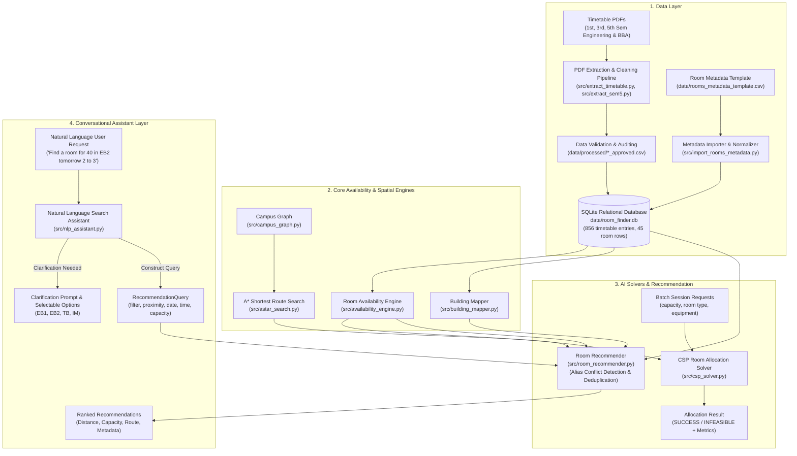
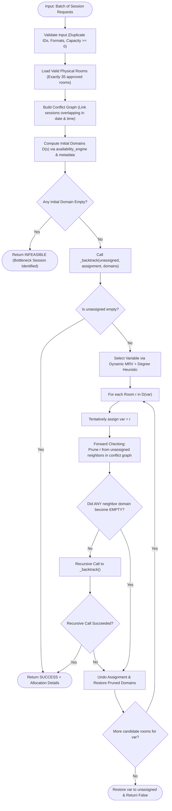

# AI Powered Intelligent Room Availability and Finder System

A university room availability, intelligent room recommendation, and spatial navigation system that integrates timetable schedule data, physical room metadata, deterministic availability search, Constraint Satisfaction Problem (CSP) algorithms, A* shortest-route campus search, and a rule-based Natural Language Search Assistant to solve academic venue scheduling and room finding.

---

## 1. Project Title
**AI Powered Intelligent Room Availability and Finder System**

---

## 2. Overview
The **AI Powered Intelligent Room Availability and Finder System** is an AI-driven academic infrastructure platform developed to automate the detection of free university classrooms, resolve room allocation bottlenecks, prevent scheduling conflicts, compute optimal campus walking routes, and empower users with a conversational search assistant.

By integrating parsed timetable PDFs across multiple semesters and faculties, normalizing physical campus facilities into structured relational schemas, and applying Artificial Intelligence algorithms (Constraint Satisfaction with Backtracking, Minimum Remaining Values, Degree Heuristic, Forward Checking, A* Shortest-Route Search, Multi-Criteria Recommendation with Physical Venue Alias Deduplication, and Natural Language Understanding), the system delivers high-precision room availability tracking, multi-session allocation, proximity-based recommendations, and conversational search.

---

## 3. Problem Statement
In higher education institutions:
- Classrooms, computer laboratories, and lecture halls are distributed across multiple blocks with varying seating capacities and specialized equipment (e.g., smartboards, projectors, lab computers).
- Timetables change dynamically across semesters, sections, elective batches, and effective date intervals (e.g., date-dependent venue handovers).
- Ad-hoc room bookings, guest lectures, makeup classes, and examination schedules often lead to double-bookings, capacity mismatches, or venue underutilization.
- Finding free, suitable rooms manually is error-prone, labor-intensive, and time-consuming.
- Users often need rooms near their current location, but computing walking routes and proximity manually across campus complexes is cumbersome.
- Physical venues sometimes have dual identities (e.g., `IET Amphitheatre` and `EB-006 (IET)`), which can cause double-booking or duplicate recommendations if treated as separate entities.
- Non-technical faculty and students require a conversational interface to query rooms using plain English (e.g., *"Find a classroom for 40 students near EB2 tomorrow from 2 to 3 with a projector"*).

---

## 4. Project Objectives
- **Centralize Campus Timetable & Venue Data:** Digitize, validate, and store heterogeneous academic timetable schedules and room inventory into a unified SQLite database.
- **Accurate Temporal Conflict Detection:** Ensure non-overlapping intervals, date-dependent ranges, and alternate venue allocations are handled deterministically without false positives.
- **Intelligent Constraint-Based Room Allocation:** Formulate and solve multi-session room assignment as a Constraint Satisfaction Problem (CSP) satisfying capacity, room type, facilities, timetable commitments, and mutual exclusion.
- **Spatial Campus Routing via A\* Search:** Model academic complexes as a weighted graph and compute provably optimal walking routes and distances using admissible and consistent heuristics.
- **Multi-Criteria Room Recommendation:** Rank available rooms based on spatial proximity (A* distance), seating capacity right-sizing, room classification, and facility requirements.
- **Physical Venue Alias Deduplication:** Detect and resolve co-referent venue aliases (e.g., `IET Amphitheatre` and `EB-006 (IET)`), preventing cross-alias double bookings and duplicate recommendations.
- **Natural Language Search Assistant:** Provide a zero-dependency, rule-based NLP assistant supporting general, building-filtered, proximity, ambiguous-building clarification, and detailed queries with robust validation.

---

## 5. Technologies Used
- **Programming Language:** Python 3.10+
- **Database Engine:** SQLite 3 (with foreign key constraints enabled)
- **Data Processing:** Python Standard Library (`sqlite3`, `csv`, `pathlib`, `datetime`, `dataclasses`, `typing`, `unittest`, `heapq`, `re`, `calendar`)
- **PDF Extraction & Auditing:** Automated extraction pipeline parsing tabular PDF schedules into validated CSV datasets

---

## 6. Project Architecture / Workflow



---

## 7. Campus Building Information

The campus facilities modeled in the system span four primary academic building complexes:

| Building Code / Prefix | Building Full Name | Typical Facilities |
| :--- | :--- | :--- |
| **`EB1-`** | Engineering Block 1 (EB-1) | Standard Classrooms (Capacity 60) |
| **`EB2-`** | Engineering Block 2 (EB-2) | Standard Classrooms (Capacity 60) |
| **`TB-`** | Technology Block (TB) | Large Classrooms (Capacity 80) |
| **`IM-`** | Management Block (IM) | Management Classrooms (Capacity 60) |
| **Specialized Venues** | Campus Amphitheatres, LRC, AIC | Seminar Rooms (Capacity 100), Computer Labs (Capacity 60) |

### Assumed Campus Walking Distances
For future spatial route-finding and allocation optimization, the following walking distances are currently adopted:

| Route Between Buildings | Assumed Distance |
| :--- | :---: |
| **EB2** $\longleftrightarrow$ **EB1** | **5 metres** |
| **EB1** $\longleftrightarrow$ **Technical Block (TB)** | **10 metres** |
| **EB1** $\longleftrightarrow$ **Management Building (IM)** | **40 metres** |
| **EB2** $\longleftrightarrow$ **Management Building (IM)** | **50 metres** |

> **Note on Spatial Data:** These distances represent **approximate initial assumptions** for algorithmic route modeling and do not constitute measured campus geodetic survey data.

---

## 8. Database and Dataset

The system uses an SQLite database located at `data/room_finder.db`.

### Core Database Tables

#### 1. `rooms` (45 total records, 35 active physical rooms)
Stores campus rooms, laboratories, seminar halls, and tracking status.
| Column | Type | Constraints | Description |
| :--- | :--- | :--- | :--- |
| `room_id` | INTEGER | PRIMARY KEY AUTOINCREMENT | Unique room identifier |
| `room_number` | TEXT | NOT NULL | Room code (e.g., `"EB1-101"`, `"TB-102"`, `"BYOD"`) |
| `building` | TEXT | NOT NULL | Building block designation |
| `capacity` | INTEGER | NULLABLE | Maximum seating capacity (60, 80, 100) |
| `room_type` | TEXT | NULLABLE | Room classification (`Classroom`, `Computer Lab`, `Seminar Room`) |
| `equipment` | TEXT | NULLABLE | Comma-separated equipment (`AC`, `Smartboard`, `Projector`, `Computers`, etc.) |
| `notes` | TEXT | NULLABLE | Audit annotations or historical classification notes |

#### 2. `timetable_entries` (856 approved records)
Stores scheduled class sessions, lectures, and laboratory blocks.
| Column | Type | Constraints | Description |
| :--- | :--- | :--- | :--- |
| `entry_id` | INTEGER | PRIMARY KEY AUTOINCREMENT | Unique timetable entry ID |
| `room_number` | TEXT | NOT NULL | Foreign key referencing room |
| `department` | TEXT | NULLABLE | Academic department offering the course |
| `semester` | TEXT | NULLABLE | Academic semester (e.g., `"1st Semester"`, `"5th Semester"`) |
| `section` | TEXT | NULLABLE | Class section / batch identifier |
| `subject` | TEXT | NULLABLE | Subject name, course code, and faculty details |
| `day` | TEXT | NULLABLE | Day of the week (`Monday` to `Friday`) |
| `start_time` | TEXT | NULLABLE | Class start time in 24-hour format (`HH:MM`) |
| `end_time` | TEXT | NULLABLE | Class end time in 24-hour format (`HH:MM`) |
| `source_file` | TEXT | NULLABLE | PDF file from which the entry was ingested |
| `effective_start_date`| TEXT | NULLABLE | Start date for date-dependent classes (`YYYY-MM-DD`) |
| `effective_end_date` | TEXT | NULLABLE | End date for date-dependent classes (`YYYY-MM-DD`) |
| `schedule_type` | TEXT | NULLABLE | Schedule cadence (e.g., `"Regular Weekly"`) |
| `duration_minutes` | INTEGER | NULLABLE | Duration of the session in minutes |
| `notes` | TEXT | NULLABLE | Extraction and schedule notes |
| `needs_verification` | INTEGER | DEFAULT 0 | Flag for ambiguous entries (0 = verified) |
| `verification_reason`| TEXT | NULLABLE | Reason if verification required |
| `is_alternate_venue` | INTEGER | DEFAULT 0 | 1 if alternate or practical venue notation |

#### 3. `source_files`
Tracks metadata for source timetable PDF documents.
| Column | Type | Constraints | Description |
| :--- | :--- | :--- | :--- |
| `source_id` | INTEGER | PRIMARY KEY AUTOINCREMENT | Unique source file record ID |
| `file_name` | TEXT | NOT NULL | Name of the source timetable PDF |
| `department` | TEXT | NULLABLE | Department covered by the document |
| `semester` | TEXT | NULLABLE | Semester covered by the document |

### Approved Dataset Statistics
- **Total Approved Timetable Entries:** **856 entries**
  - *Engineering 1st Semester:* 298 entries
  - *Engineering 3rd Semester:* 184 entries
  - *Engineering 5th Semester:* 242 entries
  - *BBA Timetable:* 132 entries
- **Unresolved Visiting Faculty Entries:** **2 entries** (deliberately preserved in `data/processed/visiting_faculty_unresolved.csv` and excluded from physical room occupancy until venues are officially confirmed).
- **Physical Room Inventory:** **35 approved physical rooms** with complete metadata. Canonical `TB-109` is included (Capacity 80, Classroom, full equipment), while spaced alias `TB- 109` and non-physical strings (`EB1-1`, `EB1-2`, `EB2-2`, `EB2-4`, `TB-102/108`, `TB-102/112`, `Unassigned`, `Unspecified / TBD`) are strictly excluded.

---

## 9. Implemented Modules

### 1. Database Initialization & Utilities (`src/database.py`)
- Initializes `rooms`, `timetable_entries`, and `source_files` tables.
- Enforces SQLite foreign key constraints via `PRAGMA foreign_keys = ON;`.
- Provides safe, idempotent connection and table creation helpers.

### 2. Timetable PDF Processing Pipeline
- `src/extract_timetable.py` & `src/extract_sem5.py`: Parses PDF schedules into structured tabular records.
- `src/validate_data.py`: Audits time formatting, day names, duplicate rows, multi-slot classes, and date ranges.
- `src/create_approved_dataset.py`: Normalizes date splits (e.g., FinTech Monday class in IET Amphitheatre from Aug 3–31, transitioning to IM Amphitheatre from Sep 1–Dec 15).
- `src/import_to_db.py`: Safely populates `rooms` and `timetable_entries` without creating duplicate records.

### 3. Room Metadata Management (`src/import_rooms_metadata.py`, `src/export_rooms_template.py`)
- Standardizes room types (`Classroom`, `Computer Lab`, `Seminar Room`), seating capacities (60, 80, 100), and facilities (`AC`, `Smartboard`, `Projector`, `Computers`, `Wi-Fi`, `Power sockets`).
- Creates automated database snapshots in `data/backup/` before any updates.
- Export utility generates `data/rooms_metadata_template.csv` for manual inspection.

### 4. Room Availability Engine (`src/availability_engine.py`)
- Core function: `find_available_rooms(date_str, start_time_str, end_time_str, min_capacity=0)`.
- Validates 24-hour time formatting and calendar dates.
- Translates calendar dates to weekdays and evaluates whether entries fall within `[effective_start_date, effective_end_date]`.
- Implements strict interval non-overlap condition:

  $$
  \neg (\text{entry.end\textunderscore time} \le \text{req.start\textunderscore time} \lor \text{entry.start\textunderscore time} \ge \text{req.end\textunderscore time})
  $$

- Returns matching free rooms sorted by `room_number`.

### 5. CSP Room Allocation Solver (`src/csp_solver.py`)
- Formulates multi-session room scheduling as a Constraint Satisfaction Problem.
- Features `SessionRequest`, `AllocationResult`, and `CSPSolver`.
- Dynamically allocates rooms for concurrent or sequential session requests using backtracking, MRV, Degree Heuristic, and Forward Checking.

### 6. Campus Graph Representation (`src/campus_graph.py`)
- Models academic campus nodes (`EB1`, `EB2`, `TB`, `IM`) and 4 bidirectional connections:
  - EB2 $\longleftrightarrow$ EB1: 5 metres
  - EB1 $\longleftrightarrow$ TB: 10 metres
  - EB1 $\longleftrightarrow$ IM: 40 metres
  - EB2 $\longleftrightarrow$ IM: 50 metres
- Implements an admissible and monotonic consistent heuristic $h(u, v)$ for A* search based on minimum hop distance scaled by minimum edge weight ($5 \times \text{min\textunderscore hops}$).

### 7. A* Shortest Route Search Engine (`src/astar_search.py`)
- Core function: `find_shortest_route(start_building, goal_building) -> RouteResult`.
- Uses `heapq` priority queue over $f(n) = g(n) + h(n)$ with deterministic tie-breaking.
- Computes exact walking routes and optimal path distances (e.g., EB2 $\rightarrow$ IM via EB1 is $5 + 40 = 45\text{ m}$, outperforming the direct 50m path).

### 8. Campus Building Mapper (`src/building_mapper.py`)
- Maps heterogeneous room numbers and building strings to canonical campus nodes (`EB1`, `EB2`, `TB`, `IM`).
- Normalizes special venues: `AIC` $\rightarrow$ `EB2`, `BYOD` & Tech Block CS Labs $\rightarrow$ `TB`, `EB-006` & `IET Amphitheatre` $\rightarrow$ `EB1`, `IM Amphitheatre` $\rightarrow$ `IM`.
- Strictly maintains unconfirmed or external specialized locations (e.g. `LRC002`, `LRC007`) as unmapped (`None`) without heuristic guessing.

### 9. Intelligent Room Recommender (`src/room_recommender.py`)
- Multi-criteria recommendation engine combining availability checking (`availability_engine`), capacity, room type, equipment filtering, and spatial proximity via A* shortest walking distance.
- Features `RecommendationQuery` and `RecommendedRoom`.
- Supports three query modes:
  - **Campus-Wide Search (`preferred_building=None`):** Evaluates all available rooms across campus without distance bias (`walking_distance=None`, `walking_route=None`).
  - **Building-Specific Filter (`filter_building="EB2"`):** Restricts candidates strictly to the canonical campus node.
  - **Proximity-Based Search (`preferred_building="EB2"`):** Computes A* walking distance and route from starting location across all eligible buildings.
- **Physical Venue Alias Deduplication:**
  - Manages co-referent venue aliases (`IET Amphitheatre` as canonical and `EB-006 (IET)` as alias).
  - Performs cross-alias conflict detection: booking either alias marks both as unavailable.
  - Returns only canonical `IET Amphitheatre` when both aliases are free, backed by canonical database metadata.
- **Deterministic Ranking:** Walking distance (ascending) $\rightarrow$ seating capacity (ascending for right-sizing) $\rightarrow$ room number (alphabetical).

### 10. Natural Language Search Assistant (`src/nlp_assistant.py`)
- Lightweight, zero-dependency rule-based conversational room search assistant.
- Core function: `process_natural_language_request(user_input, reference_now=None, include_unmapped_buildings=False) -> NLPResponse`.
- Converts plain-English queries into validated `RecommendationQuery` structures.
- Supported conversational behaviors:
  - **General Search:** *"Find an empty room now"* $\rightarrow$ campus-wide search for a 60-minute window starting from current time.
  - **Specific Building:** *"Find an empty room in EB2"* $\rightarrow$ `filter_building="EB2"`.
  - **Ambiguous Building Clarification:** *"Find an empty room in this building"* $\rightarrow$ returns `NEEDS_CLARIFICATION` status with prompt *"Which building are you referring to?"* and selectable options `["EB1", "EB2", "IM", "TB"]`.
  - **Nearby Search:** *"Find an empty room near EB2"* $\rightarrow$ `preferred_building="EB2"`.
  - **Detailed Search:** Extracts room types (`Classroom`, `Computer Lab`, `Seminar Room`), capacity (`for 40 students`), equipment (`smartboard`, `projector`, `ac`), dates (`today`, `tomorrow`, weekdays, ISO/DMY/month names), university time shorthand (`2 to 3` $\rightarrow$ 14:00–15:00), and durations (`for 1 hour`).
- **Robust Validation & Error Handling:**
  - Rejects invalid 12-hour times (`25 PM`, `13 PM`, `0 PM`) and 24-hour times (`25:00`, `10:75`).
  - Rejects impossible dates (`2026-99-45`, `31/02/2026`) immediately before query construction without generating invalid derived times.
  - Rejects negative durations (`for -2 hours`), zero duration (`for 0 minutes`), and durations extending past midnight.
  - Rejects inverted ranges (`from 15 to 10`).
  - Returns structured `NLPResponse(status="ERROR", error_message=...)` without application crashes.

---

## 10. Algorithmic Deep Dives

### 10.1 CSP Room Allocation Algorithm
The CSP solver assigns physical rooms to academic session requests satisfying all hard constraints:



#### Key AI Techniques in CSP Solver:
1. **Backtracking Search (DFS):** Systematically explores assignments and backtracks upon conflict.
2. **Dynamic Minimum Remaining Values (MRV):** Prioritizes sessions with the smallest domain size $|D(s)|$.
3. **Degree Heuristic Tie-Breaker:** Breaks MRV ties by selecting the session with the most unassigned conflicting neighbors.
4. **Forward Checking with Exact Domain Restoration:** Immediately prunes assigned rooms from conflicting neighbors, detecting domain wipeouts early with localized restoration.

### 10.2 A* Shortest Route Search Algorithm
The A* search algorithm computes the optimal walking path and distance between campus buildings:
- **Evaluation Function:** $f(n) = g(n) + h(n)$
  - $g(n)$: Exact accumulated walking distance from starting building to node $n$.
  - $h(n)$: Admissible heuristic $h(n) = 5 \times \text{min\textunderscore hops}(n, \text{goal})$, guaranteeing that $h(n) \le h^\ast(n)$ for all pairs.
- **Consistency (Monotonicity):** For any edge $(u, v)$ with weight $w(u, v)$:

  $$
  h(u) \le w(u, v) + h(v)
  $$

  Ensuring no re-expansion of previously closed nodes.
- **Priority Queue:** Implemented via Python's `heapq` with entry tuple `(f_score, g_score, current_node, path)`.

### 10.3 Physical Venue Alias Deduplication
Physical venue aliases occur when multiple identifiers refer to the same physical room:
- **Canonical Venue:** `IET Amphitheatre`
- **Known Alias:** `EB-006 (IET)`
- **Cross-Alias Conflict Resolution:**
  1. Both aliases are checked for bookings in `timetable_entries`.
  2. If *either* alias is booked during the requested date/time, the *entire physical venue* is suppressed from recommendations.
  3. If *both* aliases are free, only the canonical name `IET Amphitheatre` is returned, populated with metadata loaded from the canonical database record.

---

## 11. Project Folder Structure

```text
AI_project/
├── data/
│   ├── backup/                                 # Automated database and CSV backups
│   ├── processed/                              # Validated and processed CSV datasets
│   │   ├── all_timetable_entries_approved.csv # 856 approved timetable records
│   │   ├── unique_rooms_approved.csv          # Verified room inventory
│   │   └── visiting_faculty_unresolved.csv    # 2 unresolved visiting faculty entries
│   ├── timetable_pdfs/                         # Original source timetable PDFs
│   │   ├── Time Table 1st Sem.pdf
│   │   ├── Time Table 3rd sem.pdf
│   │   ├── Time Table-5th Sem (1).pdf
│   │   └── Time_Table_Final IM V.4 from 3-Aug-26.pdf
│   ├── room_finder.db                          # Primary SQLite database
│   └── rooms_metadata_template.csv             # Room metadata inventory template
├── src/
│   ├── __init__.py                             # Package initialization
│   ├── astar_search.py                         # A* shortest-path routing between buildings
│   ├── availability_engine.py                  # Temporal availability search engine
│   ├── building_mapper.py                      # Campus node normalizer & alias resolver
│   ├── campus_graph.py                         # Spatial campus graph & heuristic functions
│   ├── count_rows.py                           # Dataset row verification utility
│   ├── create_approved_dataset.py              # Approved dataset generator
│   ├── csp_solver.py                           # CSP Room Allocation Solver (AI Engine)
│   ├── database.py                             # Database initialization and connection
│   ├── export_rooms_template.py                # Room metadata CSV export utility
│   ├── extract_sem5.py                         # Semester 5 timetable extraction script
│   ├── extract_timetable.py                    # Semester 1, 3, BBA timetable extraction
│   ├── import_rooms_metadata.py                # Idempotent room metadata database updater
│   ├── import_to_db.py                         # Timetable dataset database importer
│   ├── nlp_assistant.py                        # Natural Language Search Assistant
│   ├── room_recommender.py                     # Multi-criteria recommendation & alias engine
│   ├── test_astar_search.py                    # A* search unit tests (7 tests)
│   ├── test_availability_engine.py             # Availability engine unit tests (6 tests)
│   ├── test_building_mapper.py                 # Building mapper unit tests (8 tests)
│   ├── test_campus_graph.py                    # Campus graph & heuristic unit tests (7 tests)
│   ├── test_csp_solver.py                      # CSP solver unit tests (13 tests)
│   ├── test_nlp_assistant.py                   # NLP assistant unit tests (18 tests)
│   ├── test_room_metadata.py                   # Room metadata unit tests (7 tests)
│   ├── test_room_recommender.py                # Recommender & alias unit tests (43 tests)
│   ├── validate_data.py                        # Dataset validation and integrity auditor
│   └── verify_import.py                        # Database import verification script
├── test_db.py                                  # Database foundation test script
├── .gitignore                                  # Git ignore rules
└── README.md                                   # Project documentation
```

---

## 12. Installation and Setup

### Prerequisites
- **Python 3.10** or higher installed on your system.
- Standard terminal or PowerShell.

### Clone or Open the Workspace
```bash
cd C:\Users\deepa\OneDrive\Desktop\AI_project
```

### Verify Environment
No third-party packages or heavy dependencies are required; the entire system runs strictly on the **Python standard library**.

---

## 13. How to Run

### 1. Initialize or Verify the Database Foundation
```bash
python test_db.py
```

### 2. Query Room Availability via CLI
To find free rooms on a specific date, time slot, and minimum capacity:
```bash
python src/availability_engine.py 2026-08-10 09:00 09:50 50
```

### 3. Query Room Recommendations Programmatically
```python
from src.room_recommender import RecommendationQuery, recommend_rooms

query = RecommendationQuery(
    preferred_building="EB2",
    date="2026-08-10",
    start_time="10:00",
    end_time="11:00",
    min_capacity=40,
    required_room_type="Classroom",
    required_equipment=("Smartboard",),
)

rooms = recommend_rooms(query)
for r in rooms:
    print(f"Room: {r.room_number} | Node: {r.campus_node} | Distance: {r.walking_distance}m | Route: {' -> '.join(r.walking_route)}")
```

### 4. Search Rooms Using Natural Language
```python
from src.nlp_assistant import process_natural_language_request

# Conversational query
res = process_natural_language_request("Find a classroom for 40 students in EB2 tomorrow from 2 to 3 with a projector.")

if res.status == "SUCCESS":
    print(f"Found {len(res.recommendations)} matching rooms:")
    for r in res.recommendations:
        print(f"- {r.room_number} (Capacity: {r.capacity}, Type: {r.room_type})")
elif res.status == "NEEDS_CLARIFICATION":
    print(f"Clarification: {res.clarification_prompt}")
    print(f"Options: {', '.join(res.options)}")
else:
    print(f"Error: {res.error_message}")
```

### 5. Find Shortest Walking Routes (A* Search)
```python
from src.astar_search import find_shortest_route

route = find_shortest_route("EB2", "IM")
print(f"Route: {' -> '.join(route.path)} (Distance: {route.total_distance} metres)")
# Route: EB2 -> EB1 -> IM (Distance: 45.0 metres)
```

### 6. Run CSP Multi-Session Allocation
```python
from src.csp_solver import CSPSolver, SessionRequest

solver = CSPSolver()

sessions = [
    SessionRequest(
        session_id="CS301_Lab",
        date="2026-08-10",
        start_time="11:00",
        end_time="11:50",
        expected_students=45,
        required_room_type="Computer Lab",
        required_equipment=("Computers", "Projector"),
    ),
    SessionRequest(
        session_id="MATH101_Lecture",
        date="2026-08-10",
        start_time="11:00",
        end_time="11:50",
        expected_students=75,
        required_room_type="Classroom",
        required_equipment=("Smartboard", "AC"),
    ),
]

result = solver.solve(sessions)
if result.status == "SUCCESS":
    for session_id, alloc in result.allocations.items():
        print(f"[{session_id}] -> Room {alloc['room_number']} ({alloc['building']})")
else:
    print(f"Allocation Infeasible: {result.reason}")
```

### 7. Re-export or Re-import Room Metadata
```bash
# Export current metadata template
python src/export_rooms_template.py

# Import / update room metadata into SQLite
python -m src.import_rooms_metadata
```

---

## 14. Running Tests

The test suite covers database constraints, room metadata, availability queries, CSP solver operations, graph heuristics, A* pathfinding, building mappings, room recommendations with alias deduplication, and natural language search.

### Run All Unit and Regression Tests
Execute the test runner from the root directory:
```bash
python -m unittest discover -s src -p "test_*.py" -v
```

### Run Specific Test Modules
```bash
# 1. Test Room Availability Engine (6 tests)
python -m unittest src/test_availability_engine.py -v

# 2. Test Room Metadata & Physical Room Integrity (7 tests)
python -m unittest src/test_room_metadata.py -v

# 3. Test CSP Room Allocation Engine (13 tests)
python -m unittest src/test_csp_solver.py -v

# 4. Test Campus Graph & Heuristics (7 tests)
python -m unittest src/test_campus_graph.py -v

# 5. Test A* Search Route Navigation (7 tests)
python -m unittest src/test_astar_search.py -v

# 6. Test Campus Building Mapper (8 tests)
python -m unittest src/test_building_mapper.py -v

# 7. Test Room Recommender & Alias Deduplication (43 tests)
python -m unittest src/test_room_recommender.py -v

# 8. Test Natural Language Search Assistant (18 tests)
python -m unittest src/test_nlp_assistant.py -v

# 9. Test Database Foundation (test_db.py)
python test_db.py
```

### Current Test Suite Status
- **Total Test Cases Executed:** **109 tests**
- **Passed:** **109**
- **Failed:** **0**
- **Status:** **100% OK**

---

## 15. Current Progress

| Milestone | Status | Description |
| :--- | :---: | :--- |
| **Phase 1: Database Foundation** | **Completed** | Relational SQLite schema (`rooms`, `timetable_entries`, `source_files`) with foreign keys enabled. |
| **Phase 2: Timetable Extraction & Audit** | **Completed** | Extracted and validated 856 approved entries across 4 timetable schedules; 2 visiting faculty entries isolated. |
| **Phase 3: Room Metadata Standardization** | **Completed** | Physical room capacity, room types, and facility equipment populated; 35 approved physical rooms active. |
| **Phase 4: Room Availability Engine** | **Completed** | Temporal conflict detection, partial overlaps, capacity filtering, and date-range support fully verified. |
| **Phase 5: CSP Room Allocation Engine** | **Completed** | Backtracking Search with dynamic MRV, Degree Heuristic, Forward Checking, and exact domain restoration. |
| **Phase 6: Campus Graph & A\* Search** | **Completed** | Spatial graph modeling academic blocks, consistent admissible heuristics, and optimal route navigation. |
| **Phase 7: Building Normalization Mapper** | **Completed** | Resolves campus node codes, specialized facilities (AIC, BYOD), and strict unmapped room preservation. |
| **Phase 8: Room Recommender & Alias Fix** | **Completed** | Multi-criteria ranking, campus-wide & building filtering, and physical venue alias deduplication (`IET Amphitheatre` / `EB-006 (IET)`). |
| **Phase 9: Natural Language Search Assistant** | **Completed** | Rule-based conversational assistant supporting general, nearby, building-filtered, and detailed queries with robust validation. |
| **Phase 10: Full Regression Verification** | **Completed** | 109 automated unit tests passing across all 8 test suites with 100% success rate. |

---

## 16. Future Scope & Enhancements

The following modules represent planned future phases and research directions:

### 16.1 ML-Based Ghost Booking Detection (Research Direction)

A potential future enhancement is an ML-based Ghost Booking Detection module to identify rooms that are reserved in timetables or booking systems but may remain underutilized or vacant.

- **Objective:** Estimate the likelihood of a scheduled room reservation being unused.
- **Potential Features:** Historical room utilization, booking schedules, day of the week, time slots, room capacity, department, and course characteristics.
- **Candidate Models:** Logistic Regression, Random Forest, and Gradient Boosted Trees (XGBoost / LightGBM).
- **Data Requirements:** Reliable model training requires historical room occupancy data with verified utilization labels, potentially collected through privacy-conscious occupancy sensors, authorized attendance records, or room check-in logs.
- **Current Status:** Proposed research direction. This feature is not implemented because reliable historical occupancy labels are not currently available.

### 16.2 Interactive Streamlit Web Dashboard

- Develop an interactive web interface for campus administrators, faculty, and students.
- Visualize room availability, timetable information, and room recommendations.
- Display campus walking routes and distances.
- Integrate the Natural Language Search Assistant for conversational room discovery.

### 16.3 Institutional Calendar Synchronization & Deployment

- Explore integration with Google Calendar and Microsoft Outlook / Exchange for institutional schedule synchronization.
- Develop automated deployment pipelines and institutional schedule synchronization workflows.